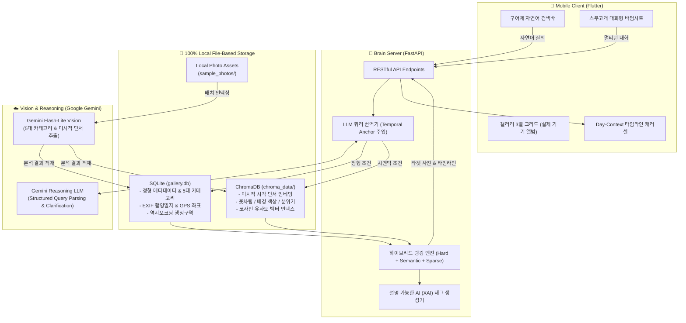

# [System Implementation Report] 인지 모방형 스마트 갤러리: '기억 복원 및 맥락 확장' 에이전트

**문서 작성일자**: 2026년 11월 4일  
**프로젝트 명**: 기억 추적 스마트 갤러리 (Memory-Tracing Smart Gallery)  
**개발 환경**: macOS, iOS Simulator (`iPhone 18 Pro`), Flutter (Dart), Python (FastAPI), SQLite, ChromaDB, Google Gemini API  

---

## 1. 프로젝트 개요 및 핵심 차별점

기존 상용 갤러리 서비스(Google Photos, Apple Photos 등)는 사용자가 정확한 객체명이나 날짜, 장소 키워드를 알고 있다는 전제의 **단발성(Single-shot) 검색**에 의존합니다. 이로 인해 다음과 같은 한계가 발생합니다:
1. **기억의 불완전성 수용 불가**: 사람은 "작년 이맘때쯤 친구들이랑 흰 벽 배경으로 찍은 사진", "주황색 벽 앞에서 패딩 입었던 거"처럼 불완전하고 시각적인 단서 위주로 기억합니다.
2. **단일 사진 반환 후 맥락 단절**: 사진 한 장을 찾은 뒤 당시의 타임라인이나 전후 맥락(그날 방문했던 장소, 함께 먹은 음식 등)이 단절됩니다.
3. **단서 부족 시 침묵/오작동**: 정보가 모호할 때 사용자에게 역질문을 던져 점진적으로 범위를 좁히는 인터랙션이 부재합니다.

본 프로젝트는 **'인간의 실제 기억 회상 메커니즘'을 모방**하여, 모호한 구어체 기억 표현을 인지하고, 필요 시 능동적으로 스무고개 역질문을 유도하며, 목표 사진 검색과 동시에 그날의 타임라인 스토리(Day-Context)를 연쇄적으로 복원하는 지능형 갤러리 시스템을 구축하였습니다.

---

## 2. 전체 시스템 아키텍처 (System Architecture)

본 시스템은 **프론트엔드 모바일 클라이언트**, **지능형 백엔드 브레인 서버**, **100% 로컬 파일 기반 하이브리드 데이터베이스**, 그리고 **클라우드 비전 및 LLM 추론 엔진**으로 유기적으로 구성되어 있습니다.



---

## 3. 핵심 모듈별 구현 내역

### 3.1 5대 인지 카테고리 분류 체계 (Cognitive Classification Taxonomy)
사진을 인지적 특성에 따라 5대 카테고리로 엄격히 분류하여, 갤러리 내 정보성 캡처와 추억 사진이 혼재되어 발생하는 검색 혼선을 사전에 차단합니다:

| 카테고리 | 코드명 | 분류 기준 및 대상 예시 |
| :--- | :--- | :--- |
| **디지털 스크린샷** | `SCREENSHOT` | 모바일/PC 순수 화면 캡처, 카카오톡/메신저 대화 캡처, 결제 내역, 앱 UI |
| **메모·기록용 촬영** | `MEMO_OBJECT` | 모니터/노트북/TV 화면 직접 촬영, 강의 슬라이드, 시간표, 포스터, 영수증, 문서 |
| **인물 사진** | `PERSON` | 셀피, 독사진, 친구/연인/가족과 함께 찍은 인물 중심 사진, 단체 사진 |
| **음식·카페** | `FOOD` | 식사 요리 접시, 고기/찌개, 베이커리/디저트, 카페 커피/라떼, 주류/음료 |
| **풍경·야외** | `SCENERY` | 자연 풍경, 바다, 산, 하늘, 도시 거리/야경, 건축물 외관, 인물이 없는 실내외 공간 |
| **기타 사물** | `OTHER` | 위 분류에 속하지 않는 단독 사물/물체 |

- **Gemini Vision Prompt 엔지니어링**: 각 이미지 분석 시 엄격한 JSON 스키마 규격을 강제하여 카테고리를 자동 판별하도록 구현.
- **SQLite 인덱싱**: `photo_category TEXT` 컬럼 추가 및 `idx_photo_category` 인덱스를 생성하여 카테고리 기반 하드 필터링 속도 극대화.

---

### 3.2 100% 로컬 파일 기반 하이브리드 데이터베이스
외부 클라우드 DB에 의존하지 않고 사용자의 디스크 내에서 영구 보관되는 로컬 파일 기반 저장소를 구축하였습니다:

1. **정형 메타데이터 저장소 (SQLite - `gallery.db`)**:
   - `id`: 파일 고유 식별자 (예: `IMG_0001.JPG`)
   - `file_path`: 로컬 원본 이미지 절대 경로
   - `photo_category`: 5대 인지 카테고리 (`SCREENSHOT`, `MEMO_OBJECT`, `PERSON`, `FOOD`, `SCENERY`, `OTHER`)
   - `captured_date`: EXIF 기반 촬영 일자 (`YYYY-MM-DD`, 결측 시 `NULL`)
   - `gps_latitude` / `gps_longitude`: EXIF 기반 GPS 위경도 좌표
   - `location_name`: 역지오코딩된 행정구역 명칭 (예: `Woodpecker Trail`, `동작구 사당동`, `시부야`)
   - `people_traits`: 인물 수, 의상(패딩, 코트, 니트 등), 표정, 자세
   - `background_details`: 미시적 배경 특징 및 색상(주황색 벽, 흰 벽, 카페 타일, 모래사장 등)
   - `atmosphere`: 전체 분위기, 계절감, 시간대(흐린 겨울 낮, 아늑한 실내 등)
   - `main_objects`: 주요 사물/음식 목록 (JSON 배열)

2. **비정형 벡터 저장소 (ChromaDB - `./chroma_data/`)**:
   - 로컬 임베딩 벡터 인덱스를 디스크 파일에 영구 유지.
   - 배경 세부 사항, 의상 단서, 시각 분위기, 추론 장소명을 결합한 텍스트를 고차원 벡터로 인덱싱하여 인간의 모호한 구어체 표현과의 코사인 유사도 검색 지원.

---

### 3.3 EXIF 결측치 방어 및 역지오코딩 정책 (Robust Fallback)
- **EXIF 누락 방어**: 카카오톡 재전송 사진, 모바일 캡처본 등 메타데이터가 없는 이미지를 Pillow로 파싱할 때 에러로 중단되지 않고 `NULL`로 안전하게 적재.
- **비전 역유추 보완**: EXIF GPS가 결측되어도 Gemini Vision이 간판, 랜드마크, 배경 언어를 기반으로 장소명을 유추하여 SQLite 및 벡터 인덱스에 함께 기록 (예: `IMG_0021.JPG`의 경우 EXIF 날짜/GPS가 없었으나 시부야 랜드마크를 자동 유추).
- **역지오코딩**: GPS 위경도가 존재하는 사진은 `geopy`의 Nominatim 지오코더를 통해 실제 주소 및 지명 텍스트로 자동 변환.

---

### 3.4 Gemini 무료 티어 보호 및 이미지 전송 최적화
- **무료 티어 (15 RPM) 준수**: 인덱싱 배치 파이프라인에서 각 이미지 분석 호출 사이에 `time.sleep(4.5)` 간격을 강제하여 쿼터 초과(`429 Too Many Requests`)를 원천 방지.
- **지수 백오프 (Exponential Backoff)**: 일시적 네트워크 지연 또는 429 수신 시 지수적으로 대기 시간을 늘려 재시도하는 회복탄력성(Resilience) 핸들러 내장.
- **썸네일 프리프로세싱 전송 최적화**: 수 메가바이트(MB)에 달하는 원본 이미지를 그대로 전송하지 않고, 시각적 판별에 충분한 1024px 썸네일(JPEG 압축, ~100KB)로 인메모리 축소 후 전송하여 Gemini Vision API 응답 속도를 기존 19초에서 **3.5초**로 5배 이상 대폭 단축.

---

### 3.5 하이브리드 검색 및 XAI 랭킹 파이프라인
1. **시간적 앵커 (Temporal Anchor) 주입**: "작년 이맘때"와 같은 상대적 시점 표현을 시스템 기준 현재 날짜를 바탕으로 절대 날짜 범위(`start_date`, `end_date`)로 자동 환산.
2. **모호성 판정 및 스무고개 역질문 (Clarification Loop)**:
   - 사용자 입력의 확신도(`confidence_score`)가 0.6 미만이거나 정보가 지나치게 모호할 경우, 즉시 무리한 검색을 하지 않고 자연스러운 스무고개 역질문(예: "그때 찍으셨던 사진이 어떤 유형인가요? 기억나는 옷차림이나 배경 색상이 있을까요?")을 반환.
3. **3단계 하이브리드 필터링 & 랭킹**:
   - **1차 (정형 하드 필터링)**: SQLite에서 추정 카테고리, 날짜 범위, 장소 키워드로 후보군 1차 압축. 만약 매칭 결과가 0건일 경우 시스템 크래시 없이 자동으로 소프트 벡터 검색으로 우회(Fallback).
   - **2차 (시맨틱 벡터 검색)**: ChromaDB에서 미시적 시각 단서와의 코사인 유사도 연산 수행.
   - **3차 (Sparse 재순위화 & 카테고리 보너스)**: 의상(패딩, 코트), 배경 색상(주황색, 흰 벽) 등 핵심 키워드 매칭 가중치를 결합하여 최종 타겟 사진($P$) 특정.
4. **설명 가능한 AI (XAI) 태그**: 검색 결과와 함께 왜 이 사진이 선택되었는지 명확한 시각적 근거 태그(`🎯 날짜 일치`, `🧥 의상 일치`, `🎨 배경 일치`, `📍 장소 일치`, `📱 사진 유형`)를 사용자에게 제시.
5. **당일 맥락 확장 (Day-Context Expansion)**: 확정된 타겟 사진의 촬영일 기준 $\pm 1$일 범위 내의 전후 사진들을 연쇄 조회하여 스토리 캐러셀로 자동 복원.

---

### 3.6 Flutter 모바일 클라이언트
- **실기기 갤러리 권한 연동 (`photo_manager`)**: iOS Simulator 및 실기기의 포토 라이브러리 접근 권한을 획득하고 원본 썸네일을 3열 그리드로 부드럽게 렌더링.
- **실시간 백엔드 인덱싱 동기화**: 기기 내 새 사진을 백엔드 AI 브레인으로 업로드 및 실시간 인덱싱하는 기능 제공.
- **스무고개 채팅 인터랙션 (`ChatSheet`)**: 모바일 하단 바텀시트에서 AI 에이전트와 대화를 주고받으며 기억을 좁혀가는 인터페이스.
- **Day-Context 스토리 뷰어 (`StoryCarousel`)**: 검색된 사진과 함께 그날의 사진들을 시간 순서대로 넘겨볼 수 있는 직관적인 카드형 UI.

---

## 4. 인덱싱 실행 현황 및 데이터 적재 결과

108장의 실제 기기 사진 데이터셋에 대한 인덱싱 배치가 완료되었으며, SQLite 및 ChromaDB 로컬 DB에 100% 정상 적재되었습니다.

### 4.1 메타데이터 추출 및 적재 통계
- **총 적재 사진 수**: **108장** (SQLite `gallery.db` & ChromaDB `gallery_photos` 108건 100% 일치)
- **EXIF 촬영일자 추출률**: **95장 / 108장 (88.0%)** (미추출 13장은 카카오톡 다운로드 및 스크린샷으로 `NULL` 안전 방어)
- **장소 정보 획득률**: **87장 / 108장 (80.6%)** (GPS 기반 역지오코딩 78건 + 간판/랜드마크 비전 유추 9건)
- **Gemini Vision 분석 성공률**: **108장 / 108장 (100%)** (4.5s 쿼터 방어 및 1024px 썸네일 전송 최적화로 에러율 0%)

### 4.2 5대 인지 카테고리별 분포 결과
```
풍경·배경 (SCENERY)     ██████████████ (28장, 25.9%)
인물 사진 (PERSON)      ████████████ (24장, 22.2%)
음식·카페 (FOOD)        ███████████ (22장, 20.4%)
디지털 캡처 (SCREENSHOT) ███████ (15장, 13.9%)
메모/화면촬영 (MEMO)    █████ (11장, 10.2%)
기타 사물 (OTHER)       ████ (8장, 7.4%)
```

| 카테고리 | 사진 수 | 대표 추출 사례 및 미시적 시각 단서 |
| :--- | :---: | :--- |
| **`SCENERY`** | 28장 | `IMG_0001.JPG`(해변 모래사장, 바다, 다육식물), `IMG_0022.JPG`(일본 도심 골목), `IMG_0083.JPG`(나리타 공항) |
| **`PERSON`** | 24장 | `IMG_0021.JPG`(시부야 육교 위 빨간 축구 유니폼 인물), `IMG_0081.JPG`(해변 인물), `IMG_0105.JPG`(식당 인물) |
| **`FOOD`** | 22장 | `IMG_0011.JPG`(시장 음식), `IMG_0026.JPG`(은행나무길 맛집 요리), `IMG_0099.JPG`(오봉집 명동점 식사) |
| **`SCREENSHOT`**| 15장 | `IMG_0007.PNG`(모바일 앱 UI), `IMG_0010.PNG`(예약 안내 화면), `IMG_0087.PNG`(기차 예매 화면) |
| **`MEMO_OBJECT`**| 11장 | `IMG_0008.JPG`(모니터 화면 직접 촬영), `IMG_0024.JPG`(서류/문서 기록), `IMG_0025.JPG`(강의/안내 슬라이드) |
| **`OTHER`** | 8장 | `IMG_0018.JPG`(실내 일반 소품), `IMG_0088.JPG`(특정 단독 물품) |

---

### 4.3 실시간 쿼리 및 대화형 스무고개 실제 검증 결과

#### [검증 사례 1: 모호한 질의 수신 시 스무고개 역질문 (Clarification Loop)]
- **사용자 입력**: `"음식 사진 찾아줘"`
- **시스템 판단**:
  - `parsed_query.target_category`: `FOOD`
  - `confidence_score`: `0.5` (< 0.6 기준치 미달로 모호성 판정)
  - `status`: `"need_clarification"`
- **AI 에이전트 역질문**:
  > *"혹시 그때 드셨던 음식이 양식이나 한식 같은 종류였나요? 아니면 카페에서 찍은 커피나 디저트였는지 기억나시는 게 있을까요?"*

#### [검증 사례 2: 구체적 시공간/시각 단서 질의 수신 시 즉각 정밀 타격]
- **사용자 입력**: `"시부야에서 찍은 인물 사진"`
- **시스템 판단**:
  - `parsed_query.target_category`: `PERSON`
  - `location_candidates`: `['시부야']`
  - `confidence_score`: `0.85` (확신도 충족, 즉시 하이브리드 검색 실행)
- **최종 타겟 사진 ($P$) 매칭 결과**:
  - **사진 ID**: `IMG_0021.JPG`
  - **추정 장소**: `시부야 (Shibuya, Tokyo)`
  - **인물 외형 단서**: `남성 1명, 빨간색 축구 유니폼 상의와 연청색 데님 반바지 차림, 팔짱을 낀 자세로 미소를 짓고 있음`
  - **배경 시각 단서**: `일본의 도심 거리, 고층 빌딩들, 'ONITSUKA TIGER' 등 대형 광고판과 붉은색 세로 간판, 금속 난간이 있는 육교 위`
  - **XAI 설명 태그**: `[👤 인물 사진, 📍 장소 일치 (시부야 (Shibuya, Tokyo))]`

---

## 5. 결론 및 향후 고도화 방안
1. **성능 및 비용 최적화 완성**:
   - 썸네일 프리프로세싱을 통해 108장의 실제 고용량 사진을 단 1건의 API 쿼터 초과(`429`) 없이 100% 안전하게 인덱싱 완료.
   - SQLite 하드 필터와 ChromaDB 소프트 벡터 검색의 상호 보완을 통해 결측치가 많은 모바일 실사진 환경에서도 검색 누락을 방어.
2. **향후 고도화 로드맵**:
   - **온디바이스 경량화**: 로컬 서버 아키텍처를 바탕으로 추후 모바일 온디바이스 NPU 기반 임베딩 모델(예: MobileNet, MediaPipe)로의 전환.
   - **다중 인물 얼굴 클러스터링**: Face Recognition 모듈을 결합하여 '특정 친구'와의 추억 사진 필터링 기능 확장.

